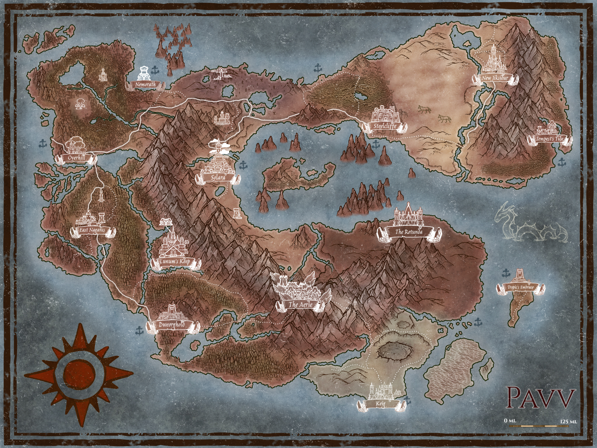

+++
title = "Cities of Pavv"
description = "A map, founding dates, city overviews, and accords."
weight = 60
sidebar = true
+++

## City List

In chronological order based on the year of founding.

1. **Overhill** — 728
1. **Keig** — 1101
1. **Solara** — 1328
1. **Tropic’s Embrace** — 2364
1. **New Jiksidur** — 2580
1. **Dweorghold** — 2789
1. **Tempest’s Tide** —2977
1. **Lunum’s Keep** — 3009
1. **Nemorath** — 3116
1. **The Aerie** — 3215
1. **Steelcliffe** — 3269
1. **The Rotunda** — 3346
1. **East Naganis** — 3429

## Overview of Pavv’s Cities

### Overhill (728)

The oldest city in Pavv, founded by druids of the Wild Circle and governed by the venerable **Council of Elders**.

### Keig (1101)

An icy hub of commerce and trade, governed by elected Wardmasters who sit in the **Stone Assembly.**

### Solara (1328)

A radiant metropolis devoted to the gods, ruled by divine scholars and priests known as the **Theurgic Council.**

### Tropic’s Embrace (2364)

A lush port city surrounded by pirate-infested waters, governed by the sea-wise **Navigator’s Council.**

### New Jiksidur (2580)

A city of magical innovation and higher learning, ruled by the archmages of the **Apex Arcanum**.

### Dweorghold (2789)

A city of spiritual enlightenment and collective wisdom, guided by an ascetic order of monk-scholars known as the **Ironmind.**

### Tempest’s Tide (2977)

A coastal stronghold ruled by pirates and privateers, where leadership shifts under the unpredictable **Stormsire.**

### Lunum’s Keep (3009)

The seat of the werewolf faction known as the **Sterling Court**, led with brutal charisma by **Fenris Demarchus** and his lieutenants.

### Nemorath (3116)

A hidden conclave of magic-wielding aquatic peoples, ruled by a mysterious body known as the **Deepcall**.

### The Aerie (3215)

A high-altitude city of winged folks and mercenaries, loosely governed by the airborne individualists known as the **Freewings.**

### Steelcliffe (3269)

A hub of industry and trade built on dwarven engineering and powerful trade guilds known as **Contract Houses**.

### The Rotunda (3346)

The only surface domain of the Ebon Aristocracy, where power flows through the opulent hands of the **Velvet Court.**

### East Naganis (3429)

A rugged city stubbornly built in the heart of werewolf-infested territory, run by the semi-feudal **Duchy of East Naganis.**

## Accords

- **The Blue Horizon Alliance (3154)** — Tropic’s Embrace, Keig
- **The Twin Sigil Accord (2581)** — New Jiksidur, Tropic’s Embrace
- **The Pilgrim Accords (2978)** — *Solara*, *Keig*, *Dweorghold*, and the *Hearthbound Republic* were the original signatories. Steelcliffe and East Naganis joined later.
