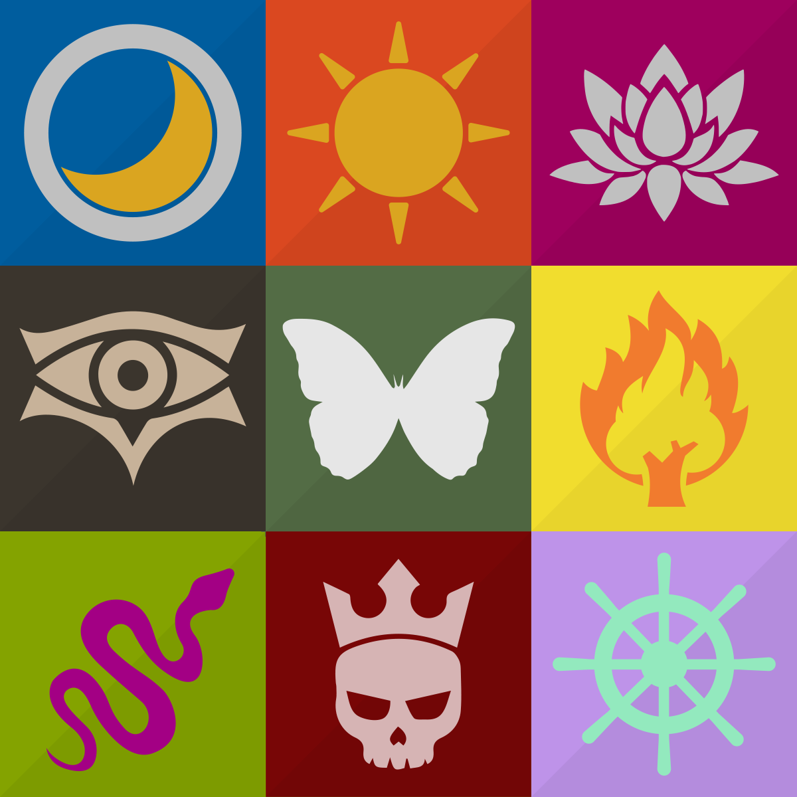

+++
title = "Pantheon of Pavv"
description = "The gods of Pavv, their aspects, domains, and symbols."
weight = 30
sidebar = true
+++

## Aspects

Though there are only 9 gods present in Pavv, each of them is capable of appearing in several other forms. These "aspects" are often created to better reflect the values or characteristics of a specific culture.

For example, the death goddess *Lyra Mortis the Unwaking* is worshipped by the dwarves of Steelcliffe as *Niamh the Scornful Widow*, goddess of the Forge. Though she appears with a different form and characteristics, they are ultimately the same entity.

**Demi-Gods**  
The immortal children of deities. Though many serve as messengers or agents for their divine parents, some grow and maintain their cults of worship by providing boons and services. It is possible for a demigod whose cult has grown popular enough to ascend to the rank of lesser god. To date, this has only occurred once, in the case of *Elara the Luminary*.

**Titans**  
Titans are legendary beasts and monsters, often created as servants to the gods. Many exist across the land, though their nature and purpose are often elusive.

**Divine-Touched (Heroes)**  
These near-immortals can draw divine power and strength from those who worship them, similar to the gods. This trait is often gained by the offspring of a god and a mortal, but it has also manifested in normal beings who have amassed a large, devout following. Popular bards, folk heroes, and religious figures have achieved this power.

| **Deity** | **Alignment** | **Domain** | **Portfolio** |
| --- | --- | --- | --- |
| ***Elara the Luminary*** | LG | Twilight, Order | Moon, Beauty, Justice, Law |
| ***Aetherion the Harmonious*** | NG | Light, Knowledge | Sun, Music, Art, Creativity |
| ***Seraphina the Joybringer*** | CG | Peace, Life | Love, Leisure, Sex, Fertility |
| ***Lyra Mortis the Unwaking*** | LN | Death, Arcana, Forge (Niamh only) | Darkness, Underworld, Dreams, Secrets |
| ***Lepi the Cocooned One*** | N | Nature, Life | Flying Insects, Wild Animals, Wandering Paths |
| ***Pyrona the Blaze*** | CN | Forge, Nature | Campfires, Hearths, Glassblowing, Smithing |
| ***Ravagor the Ruthless*** | LE | Grave, Knowledge | Undead, Plague, Poison, Disease |
| ***Thanar the Consuming*** | NE | War, Death, Twilight (Lunum only) | Victory, Dominance, Vengeance, Wrath, Moon (Lunum only) |
| ***Tritonia the Tempest*** | CE | Tempest, Trickery | Sea, Storms, Stars, Commerce |

## Elara the Luminary

- ***Alignment:*** *Lawful Good*
- ***Rank:*** *Lesser Deity*
- ***Domain:*** *Twilight, Order*
- ***Portfolio:*** *Moon, Beauty, Justice, Law*
- ***Symbol:*** *Two Moons*
- ***Color:*** *Sky Blue*
- ***Patron of:*** *Travelers, Peacekeepers, Adventurers*

## Aetherion the Harmonious

- ***Alignment:*** *Neutral Good*
- ***Rank:*** *Greater Deity*
- ***Domain:*** *Light, Knowledge*
- ***Portfolio:*** *Sun, Music, Art, Creativity*
- ***Symbol:*** *The Sun*
- ***Color:*** *Gold*
- ***Patron of:*** *Artists, Musicians, Bards*

## Seraphina the Joybringer

- ***Alignment:*** *Chaotic Good*
- ***Rank:*** *Greater Deity*
- ***Domain:*** *Peace, Life*
- ***Portfolio:*** *Love, Leisure, Sex, Fertility*
- ***Symbol:*** *Lotus Flower*
- ***Color:*** *Silver*
- ***Patron of:*** *Orphans, Healers, Midwives*

## Lyra Mortis the Unwaking

- ***Alignment:*** *Lawful Neutral*
- ***Rank:*** *Lesser Deity*
- ***Domain:*** *Death, Arcana, Forge (Niamh only)*
- ***Portfolio:*** *Darkness, the Underworld, Dreams, Secrets*
- ***Symbol:*** *Semi-Closed Eye*
- ***Color:*** *Tan*
- ***Patron of:*** *Scholars, Detectives, Dwarves (Niamh only)*

## Lepi the Cocooned One

- ***Alignment:*** *Neutral*
- ***Rank:*** *Lesser Deity*
- ***Domain:*** *Nature, Life*
- ***Portfolio:*** *Flying insects, Wild animals, Wandering paths*
- ***Symbol:*** *Butterfly*
- ***Color:*** *Forest Green*
- ***Patron of:*** *Lost Children*

## Pyrona the Blaze

- ***Alignment:*** *Chaotic Neutral*
- ***Rank:*** *Lesser Deity*
- ***Domain:*** *Forge, Nature*
- ***Portfolio:*** *Campfires, Hearths, Glassblowing, Smithing*
- ***Symbol:*** *Burning Tree*
- ***Color:*** *Burnt Orange*
- ***Patron of:*** *Craftsmen, Cartographers, Forest-dwellers*

## Ravagor the Ruthless

- ***Alignment:*** *Lawful Evil*
- ***Rank:*** *Greater Deity*
- ***Domain:*** *Grave, Knowledge*
- ***Portfolio:*** *Undead, Plague, Poison, Disease*
- ***Symbol:*** *Cobra*
- ***Color:*** *Byzantium (Purple)*
- ***Patron of:*** *Undertakers, Alchemists, Assassins*

## Thanar the Consuming

- ***Alignment:*** *Neutral Evil*
- ***Rank:*** *Greater Deity*
- ***Domain:*** *War, Death, Twilight (Lunum only)*
- ***Portfolio:*** *Victory, Dominance, Vengeance, Wrath, Moon (Lunum only)*
- ***Symbol:*** *Skull and Crown*
- ***Color:*** *Blood Red*
- ***Patron of:*** *Warriors, Bandits, Tieflings, Lycanthropes (Lunum only)*

## Tritonia the Tempest

- ***Alignment:*** *Chaotic Evil*
- ***Rank:*** *Lesser Deity*
- ***Domain:*** *Tempest, Trickery*
- ***Portfolio:*** *Sea, Storms, Stars, Commerce*
- ***Symbol:*** *Ship’s Helm*
- ***Color:*** *Seafoam*
- ***Patron of:*** *Merchants, Pirates, Fishermen*
