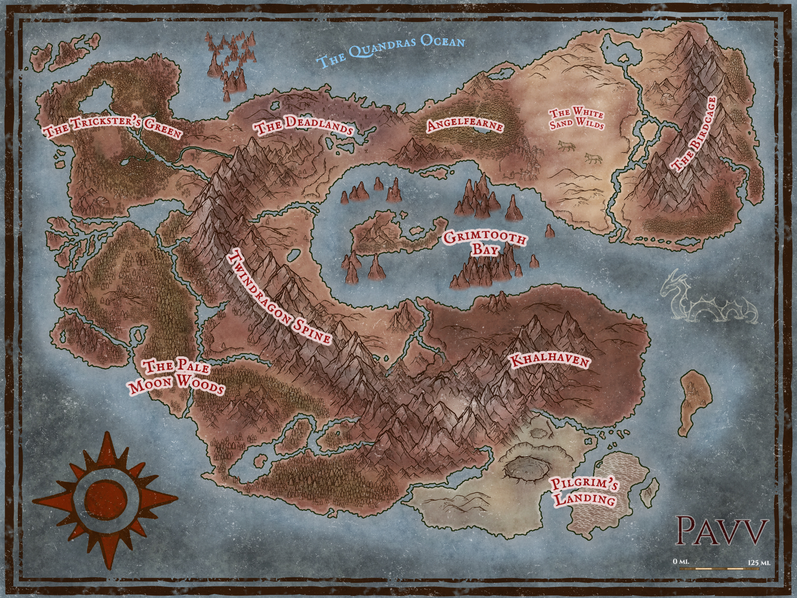

+++
title = "Regions of Pavv"
description = "A map and overview of Pavv’s regions."
weight = 50
sidebar = true
aliases = ['/atlas/', '/players/pavv/atlas/']
+++

## Region List

In Alphabetical Order

- Angelfearne
- The Birdcage
- The Deadlands
- Grimtooth Bay
- Khalhaven
- Pale Moon Woods
- Pilgrim’s Landing
- Trickster’s Green
- Twindragon Spine
- White Sand Wilds

## Overview of Regions

### Angelfearne

Nestled within the heart of Angelfearne lies an ancient, mystical forest teeming with age-old wisdom and ethereal beauty. At its center, a vast, tranquil lake shrouded in legends is believed to hold mystical properties, drawing seekers and wanderers into its enigmatic depths.

### The Birdcage

A treacherous and foreboding mountain range, named for its soaring inhabitants that rule the skies within its rugged embrace. Among its craggy peaks, harpies' haunting melodies fill the air, wyverns' venomous stingers pose deadly threats, and the majestic hippogriffs are both feared and revered by those who dare to navigate this perilous realm.

### The Deadlands

The desolate and accursed expanse harbors an ominous secret within its haunted terrain—an ancient ziggurat, once the abode of an evil dreadlord, now stands as a foreboding relic of dark power, casting an enduring shadow over this forsaken realm. The very land itself appears tainted as if bearing the weight of an ancient curse, and all who venture here must tread with caution, for the past's malevolence still lingers.

### Grimtooth Bay

Aptly named for its treacherous reefs and jagged rocks that pose formidable hazards to seafarers, a place of both beauty and peril, where mariners navigate a deadly ballet of tides and submerged dangers.

### Khalhaven

A shadowed realm carved into deep canyons and sunless stone, Khalhaven is ruled by the Ebon Aristocracy—an ancient alliance of tiefling and drow nobles bound by blood and infernal legacy. Whispers say their lineage traces back to a long-forgotten pact with a fiendish prince, whose influence still echoes through their dark courts. Beneath the surface, sprawling cities hum with forbidden magic, ruthless politics, and quiet rebellion. Outsiders are rarely welcomed—and never unobserved.

### Pale Moon Woods

Nestled beneath the moon's watchful glow, a haunting expanse is dominated by ancient forests that house feuding clans of lycanthropes. Beneath the dense canopy, secrets and grudges run as deep as the roots, making it a perilous realm for outsiders to navigate.

### Pilgrim’s Landing

Once the main battleground during the Reanimation War, it now stands as a solemn and scarred landscape, forever marked by the sacrifice of the Jiksidurian exiles who vanquished the undead menace by destroying their largest settlement. It later became a place of hope and renewal, as the Eight Pilgrims, a convoy of nonhuman refugees from distant lands, found solace and new beginnings on these hallowed grounds.

### Trickster’s Green

A beguiling tropical jungle entraps wanderers in ever-changing terrain and beguiling illusions, making navigation a test of wits and intuition. Adventurers must tread carefully to emerge unscathed from this enchanted enigma.

### Twindragon Spine

Stretching across the heart of the land, this formidable mountain range harbors whispers of two ancient dragons said to reside within its towering peaks. The jagged, snow-capped ridges and unforgiving terrain present both a perilous barrier and a tantalizing enigma to all who gaze upon its grandeur.

### White Sand Wilds

An expansive and barren desert bears the haunting legacy of a celestial conflict, once the epicenter of a divine war that left the land scorched and desolate. As far as the eye can see, the shimmering dunes whisper ancient secrets and stories of the gods' fierce battles, their legacy etched in the windswept sands and unyielding emptiness.
